### Repositories worth opening

| Repository | What it is | Proof |
|---|---|---|
| **[Heat-Pump Grants · BUS Insights](https://github.com/AyushSinghRaghuwanshi/uk-boiler-upgrade-scheme-analysis)** | UK Boiler Upgrade Scheme analysis using six official datasets, interrupted time series and predictive modelling across 316 councils, presented in a custom Flask dashboard. | +48.0% mean monthly applications in selected periods (observational, not causal) · geographic CV rate MAE 1.214 vs 2.412 for the pooled baseline, per 1,000 households |
| 📄 **[docflow](https://github.com/AyushSinghRaghuwanshi/docflow)** | Invoices in, verified data out. A Qwen2.5 model extracts each field, every value is grounded in the source, financial checks and duplicate detection run on top, and anything uncertain goes to a person. QLoRA fine-tuning of Qwen2.5-VL-3B lifted accuracy on real receipts. | 91.3% field accuracy on 347 SROIE receipts (baseline 85.5%) · 131 tests in CI |
| 🛡️ **[lineguard-secureops-assistant](https://github.com/AyushSinghRaghuwanshi/lineguard-secureops-assistant)** | A hybrid RAG assistant for industrial cybersecurity triage over 3,785 CISA advisories, with a red-teamed safety router. | Hit@5 0.95 (baseline 0.80) · 3rd place, AAI Tech Talks Hackathon 2026 |
| 📊 **explainable-ai** *(MSc dissertation, public after marking)* | Predicts high-energy events across 20 factory machines with LightGBM, then explains them with SHAP and temporal-precedence analysis in a Streamlit dashboard. | PR-AUC 0.80 on a held-out test (persistence baseline 0.52) |

### Releases

- **Publications:** [Deep learning for dental implant planning](https://ieeexplore.ieee.org/document/10010527) (IEEE GECOST 2022) · [Multi-model deep learning to scale the severity of mental disorders](https://ieeexplore.ieee.org/document/10010680) (IEEE GECOST 2022) · Spatio-temporal graph CNNs for outlier detection (IRJET 2021)
- **Certifications:** AWS Certified Machine Learning Engineer – Associate · Certified AI Ethics & Governance Professional
- **Recognition:** 3rd place, AAI Tech Talks Hackathon 2026 (WMG, Warwick) · Warwick Award for 100+ hours of skills development

Linked repositories document the evaluation methods, baselines and limitations behind the reported results.
